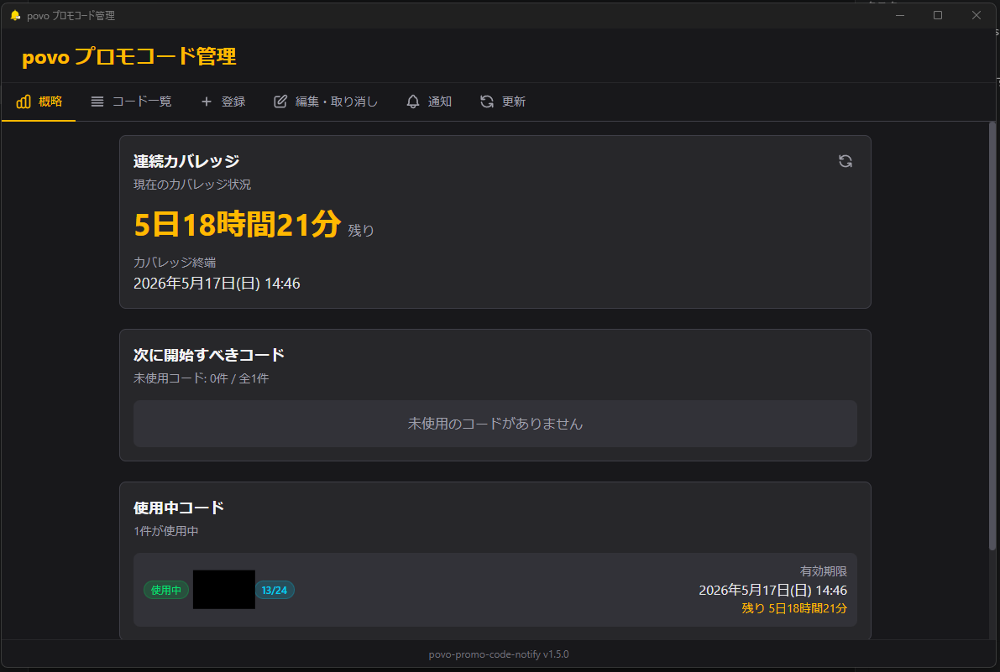
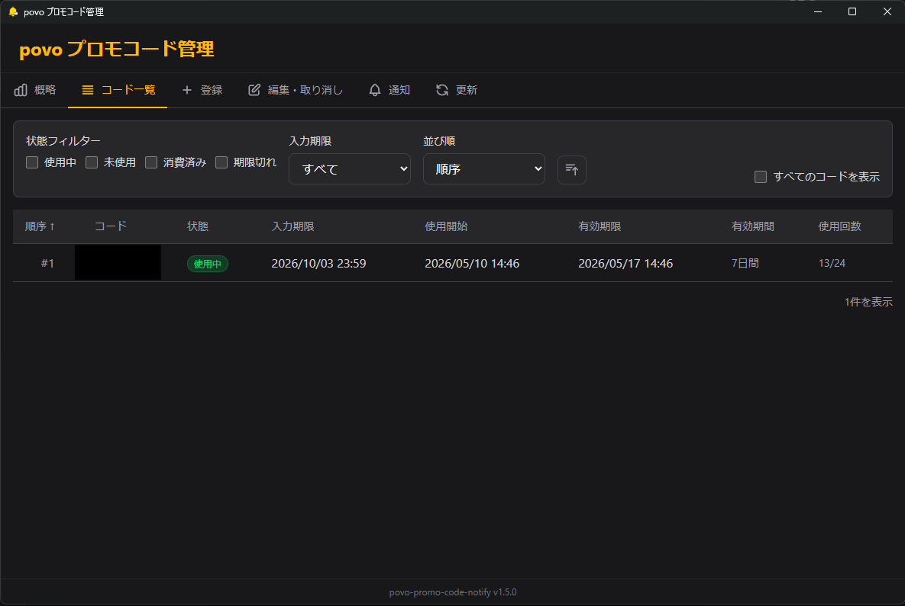

# povo プロモコード管理

povo 2.0のプロモコードを管理するWindows 11向けデスクトップアプリケーションです。

## 概要

povo 2.0では「データ使い放題」などのトッピングをプロモコードで取得できます。複数のコードを管理し、入力期限・有効期限を追跡することで、回線が途切れることなくサービスを継続利用できます。

このアプリは次の課題を解決します。

- 複数のプロモコードの一元管理
- コード入力期限の見落とし防止
- 使用中コードの有効期限切れの事前通知
- 連続カバレッジ（回線が途切れない期間）の可視化

## 機能

### ダッシュボード（概略タブ）

- **連続カバレッジ表示**: 現在の回線有効期間と残り時間をリアルタイムで表示
- **ギャップ警告**: カバレッジが途切れる可能性がある場合に警告を表示
- **次に開始すべきコード**: 未使用コードから最適な候補を提案
- **使用中コード一覧**: アクティブなコードの状態を一覧表示
- **統計情報**: 全コード数、使用中、未使用、完了・期限切れの集計

### コード一覧タブ

- 全てのプロモコードを一覧表示
- ステータス別のフィルタリング（未使用/使用中/有効期限切れ/入力期限切れ）
- コードの詳細情報（入力期限、有効期限、有効期間）の確認

### 登録タブ

- **メール本文からの自動抽出**: povoから届くメールの本文を貼り付けるだけで、コード・入力期限・有効期間を自動抽出
- **手入力**: 自動抽出できない場合は手動でコードを追加可能
- **一括登録**: 複数コードをまとめて登録
- **並べ替え**: ドラッグ&ドロップでコードの使用順序を調整

### 編集タブ

- 登録済みコードの編集・削除
- ステータスの手動変更（使用開始/使用中断など）
- コード順序の変更

### 通知タブ

- **利用終了通知**: 使用中コードの有効期限が近づくと通知（既定: 24時間前、3時間前、1時間前、30分前）
- **公式入力期限通知**: 未使用コードの入力期限が近づくと通知（任意設定）
- **カスタム閾値**: 通知タイミングを自由にカスタマイズ
- **テスト通知**: 通知機能の動作確認
- **データエクスポート/インポート**: JSON形式でのバックアップと復元

## 使い方

### 初回セットアップ

1. [Releases](https://github.com/roflsunriz/povo-promo-code-notify/releases) から最新のインストーラー（`povo-promo-code-notify-*-setup.exe`）をダウンロード
2. インストーラーを実行してアプリをインストール
3. アプリを起動

### コードの登録

1. povoからプロモコードが届いたメールを開く
2. メール本文をコピー（Ctrl+A → Ctrl+C）
3. アプリの「登録」タブを開く
4. テキストエリアに貼り付け（Ctrl+V）
5. 「抽出」ボタンをクリック
6. 抽出結果を確認し、必要に応じて編集
7. 「登録」ボタンをクリック

### 日常の運用

1. アプリを起動しておく（タスクトレイに常駐）
2. ダッシュボードで連続カバレッジを確認
3. 通知が届いたら、次のコードを povo アプリで入力
4. 「編集」タブで使用開始したコードのステータスを更新

### Windows ログオン時に自動起動する

インストール先に同梱される PowerShell 7 スクリプトを実行すると、ユーザーログオン時の自動起動を対話形式で設定できます。

```powershell
& "$env:LOCALAPPDATA\Programs\povo-promo-code-notify\register-logon-task.ps1"
```

スクリプトでは次の起動方式を選択できます。

- 表示して起動: ログオン時にメインウィンドウを表示
- トレイへ起動: `--start-in-tray` 引数を指定し、画面を表示せずタスクトレイへ常駐

同じタスク名、登録時の指紋、または同じ実行ファイルを持つ既存タスクが見つかった場合は、対象を一覧表示します。削除を確認してから登録へ進み、削除を拒否した場合は既存タスクを変更せず登録を中止します。

インストール先を変更した場合は、実行ファイルを明示できます。

```powershell
& "C:\任意のインストール先\register-logon-task.ps1" `
  -ExecutablePath "C:\任意のインストール先\povo-promo-code-notify.exe"
```

登録後のアプリ起動には PowerShell を介さず、タスクスケジューラから実行ファイルを直接起動します。

### 通知設定のカスタマイズ

1. 「通知」タブを開く
2. 利用終了通知の閾値を有効/無効に切り替え
3. 必要に応じてカスタム閾値を追加
4. 「設定を保存」をクリック

### データのバックアップ

1. 「通知」タブを開く
2. 「エクスポート」をクリック
3. 保存先を選択してJSONファイルを保存

### データの復元

1. 「通知」タブを開く
2. 「インポート」をクリック
3. バックアップしたJSONファイルを選択
4. 確認ダイアログで「インポート実行」をクリック

## 技術スタック

具体的な手順・構成・知見は [findings.md](<findings.md#readme-4>) に移動しました。着手前に該当条件を確認してください。

## 開発者向け情報

具体的な手順・構成・知見は [findings.md](<findings.md#readme-5>) に移動しました。着手前に該当条件を確認してください。

### 環境構築

本文は [findings.md](<findings.md#readme-5>) を参照してください。

#### 前提条件

本文は [findings.md](<findings.md#readme-5>) を参照してください。

#### セットアップ

本文は [findings.md](<findings.md#readme-5>) を参照してください。

### 開発コマンド

本文は [findings.md](<findings.md#readme-5>) を参照してください。

### 環境変数

本文は [findings.md](<findings.md#readme-5>) を参照してください。

### ディレクトリ構造

本文は [findings.md](<findings.md#readme-5>) を参照してください。

### リリース手順

本文は [findings.md](<findings.md#readme-5>) を参照してください。


## 運用・デプロイ

具体的な手順・構成・知見は [findings.md](<findings.md#readme-6>) に移動しました。着手前に該当条件を確認してください。

## トラブルシュート

### アプリが起動しない

1. `%APPDATA%\povo-promo-code-notify\logs\app.log` を確認
2. 依存関係の問題がある場合は再インストール:
   ```bash
   bun install
   bun build
   ```

### 通知が届かない

1. アプリが起動していることを確認
2. Windowsの通知設定で「povo プロモコード管理」が許可されているか確認
3. 「通知」タブでテスト通知を送信して動作確認

### データが消えた

1. 自動バックアップは `%APPDATA%\povo-promo-code-notify\backups\` に保存されています
2. インポート機能で復元可能

### メールからコードが抽出できない

1. メール本文全体（ヘッダーを含む）をコピーしてみる
2. 手入力フォームから追加する
3. 英数字10〜20文字のコードパターンのみ抽出対象です

## FAQ

**Q: アプリを閉じても通知は届きますか？**
A: デフォルトでは閉じるボタンを押すとタスクトレイに常駐し、通知をお届けします。また、トレイアイコンをダブルクリックするとウィンドウを表示します。

**Q: コードの「入力期限」と「有効期限」の違いは？**
A: 「入力期限」はpovoアプリにコードを入力できる期限、「有効期限」は入力後に通信サービスが有効な期限です。

**Q: 複数のPCで使えますか？**
A: エクスポート/インポート機能でデータを移行できます。ただし自動同期はサポートしていません。

**Q: データはどこに保存されますか？**
A: `%APPDATA%\povo-promo-code-notify\` フォルダに保存されます。

## ライセンス

MIT License

## 依存更新の自動処理

具体的な手順・構成・知見は [findings.md](<findings.md#readme-10>) に移動しました。着手前に該当条件を確認してください。
